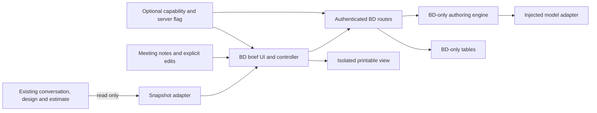

# BD meeting brief: product and implementation plan

**Status:** Proposed; not implemented or deployed.

**Prepared:** 2026-11-05.

**Baseline:** Alichitect at `dda7227`, including the locally committed report and workshop improvements. This baseline does not establish what is live in production.

## 1. Intended outcome

Give a business development person a concise, editable working brief for the next customer conversation. It should help them understand the business opportunity, involve the right people, ask the missing questions and agree a useful next engagement with an SA.

The feature supports in-person discovery. It does not qualify a deal automatically, manage a sales pipeline or replace the customer's judgment with a score.

**Recommended implementation:** an optional module within the current application, with its own state, storage, endpoints and presentation. It reads a snapshot of existing work and never becomes a dependency of architecture, pricing, reports or MCP.

The main acceptance condition is reversibility: disabling or removing the module must leave existing customer sessions and platform workflows usable, without a session-data migration or restoration from backup.

## 2. What the BD sees

### Before a meeting

1. Open an existing conversation and choose **Prepare customer meeting**. A completed diagram or estimate is not required if the conversation already contains useful customer context.
2. Optionally enter the meeting objective and attendees. Neither field blocks preparation.
3. Generate a working brief using the current conversation and available design/pricing evidence.
4. Edit the brief, answer the most useful missing questions, or leave them explicitly unknown.
5. Copy the brief or open its printable view for meeting preparation.

The first screen should contain:

| Area | Content | Editorial limit |
| --- | --- | --- |
| Opportunity | Customer problem, business impact and why they might act now | One short paragraph; unknown impact or timing stays unknown |
| Proposed value | How the proposed approach could help, with relevant evidence | Up to three labeled points |
| People to involve | Stakeholders already mentioned and roles still needed | Distinguish named people from suggested roles |
| Questions for the meeting | Questions whose answers could change scope, feasibility or the next engagement | At most three priority questions; additional context stays expandable |
| Concerns to address | Stated objections or clearly labeled possible concerns, with a way to investigate them | Up to three |
| Next engagement | Discovery, SA workshop or PoC scoping, including the decision that meeting should enable | One recommended next action; owner/date only if known |

Do not invent a budget, buying intent, urgency, economic buyer, competitor, savings figure, probability of closing or agreed next step. For example, an IT contact is not automatically the budget approver.

### After a meeting

1. Paste notes and identify the meeting date and source, where known.
2. Select **Review meeting updates**.
3. Show proposed changes beside the saved brief: newly stated facts, answered questions, unresolved conflicts and proposed actions.
4. The BD accepts individual changes or edits them. An AI-generated update must not overwrite the BD's edits silently.
5. Save a new brief version and use it to prepare the next conversation.

Meeting notes remain in this module. They are not automatically added to the architecture conversation, pricing inputs, customer report or MCP workshop context. A user can deliberately copy relevant text into an existing workflow using its normal input.

### First-release scope

- One active brief per account and browser conversation, with bounded version history.
- English, Korean and Chinese; normal keyboard, screen-reader and mobile support.
- Manual editing, notes, reviewed updates, copy and a printable brief.
- Internal working document labeling. A BD brief can contain commercial hypotheses and is not the existing client-facing proposal.
- Existing account authentication; no new BD account tier or permissions hierarchy.

Defer CRM synchronization, autonomous emails, lead enrichment, pipeline scoring, calendar integration, automatic reminders, new file uploads, independent opportunity creation and new MCP tools. The current MCP workshop tool remains available independently.

## 3. Current codebase and integration boundaries

These are existing seams, not instructions to refactor the platform wholesale:

| Existing component | Current role | Proposed interaction |
| --- | --- | --- |
| [SessionRecord](../apps/web/src/store/types.ts) and [session storage](../apps/web/src/store/sessions.ts) | Browser sessions, conversation memory, revisions and pricing | Read a committed snapshot; add no BD fields to this schema or its localStorage records |
| [Header](../apps/web/src/shell/Header.tsx) | Existing design, estimate and export controls | Add one optional feature entry with its own dialog; preserve existing controls and navigation |
| [Account response parser](../apps/web/src/stream/account.ts) | Parses signed-in account information | Accept an optional capability flag; missing or invalid flag means disabled without invalidating the account |
| [Worker entry point](../apps/worker/src/index.ts) | Authentication, same-origin checks and route dispatch | Advertise the optional capability and register a bounded route prefix after existing approved-account checks |
| [Worker environment](../apps/worker/src/env.ts) | Typed bindings and configuration | Add optional, default-off module settings |
| [Report authoring](../packages/core/src/proposal.ts) and [PDF renderer](../apps/web/src/export/pdf.ts) | Existing proposal generation | No import of BD code, new mandatory inputs or automatic inclusion of BD notes |
| [MCP workshop](../apps/worker/src/mcp-workshop.ts) | Evidence and instructions for an IDE-authored deck | Unchanged in the first release; no dependency on a BD brief |

Do not put the new module into the architecture controller, session reducer or design prompt merely because those paths already support a conversation.

## 4. Module architecture



There is no path from the BD engine back into design memory, pricing state or report inputs. Shared authentication and low-level model transport are platform services supplied to the module.

### Proposed files

All paths below are proposed additions unless identified as existing integration seams above.

```text
packages/bd-brief/src/
  types.ts             # Versioned input/output contracts owned by this module
  validate.ts          # Input, generated output and evidence-reference validation
  evidence.ts          # Snapshot normalization, fingerprints and source references
  prompt.ts            # BD-specific writing and update instructions
  engine.ts            # Bounded generation; accepts an injected model interface
  changes.ts           # Proposed changes, conflicts and reviewed application
packages/bd-brief/test/

apps/web/src/features/bd-brief/
  entry.tsx            # Small capability gate and lazy-loading boundary
  host-adapter.ts      # Only bridge to existing app selectors/account/context
  snapshot.ts          # Copy the relevant committed state into the input contract
  BriefDialog.tsx
  controller.ts        # Separate brief state, cancellation and save/version handling
  api.ts
  print.tsx            # Separate print surface; does not change proposal rendering
  styles.css           # Module-scoped selectors
  strings.json         # Module-local EN/KO/ZH copy
  *.test.ts

apps/worker/src/features/bd-brief/
  routes.ts            # Prefix dispatch and module-specific authorization checks
  repository.ts        # Every query includes the authenticated owner
  model.ts             # Adapts existing model transport to the injected interface
  policy.ts            # Feature flag, limits, request leases and cost caps
  *.test.ts

apps/worker/migrations/<next>_bd_briefs.sql
```

Use the repository's existing TypeScript/build conventions. A separate package folder is a source boundary, not a new service or required package-registry publication. Add an alias only if needed by the existing build tooling; do not create a plugin framework for one feature.

### Dependency rules

1. The module's domain contracts do not import React, Worker bindings, the main controller or `SessionRecord`.
2. Host adapters translate existing data into those contracts and return copies, never mutable references to app state.
3. Existing design, pricing, report and MCP modules must not import `bd-brief`.
4. The engine receives model and clock/ID dependencies explicitly; it does not read global credentials or register work at import time.
5. Reuse pure existing helpers through adapters when useful, such as pricing freshness checks and catalog lookup. Do not call report generation or the MCP transport to obtain evidence.
6. Do not restructure working components solely to share a small evidence mapping. A later extraction of genuinely shared logic should be a separate, tested change.

## 5. Enablement and failure isolation

Use a server-side `BD_BRIEF_ENABLED` setting, defaulting to false. When enabled, expose an optional capability such as `features.bdBrief: true` in the existing authenticated `/api/me` response. Missing capability means unavailable; it must not make account parsing fail.

Use the same server-side eligibility function for capability advertising and every feature route, including any trial-account allowlist. A caller cannot gain trial access by setting the browser flag manually.

- The small web entry renders nothing when disabled. It does not load the feature's main code, request BD data, mount its dialog or register feature timers.
- Load the full UI only when the user opens it, inside a local error boundary. A loading or rendering failure must not crash the surrounding design screen.
- The Worker checks the setting on every BD request. A stale browser cannot bypass a disabled server; return a structured not-available response and keep the existing app usable.
- Capability discovery must not require BD tables to exist or call a model. A missing feature table should fail only a BD route, not `/api/me` or application boot.
- Keep the module's request state, abort controller, concurrency lease and rate limit separate from architecture/pricing/report turns. Opening, saving or generating a brief must not toggle the main application's busy state or spend a chat turn.
- Capture context when generation starts. If the user switches sessions, changes language, closes the dialog or signs out, discard stale UI callbacks and cancel work where possible. Never display one account's or session's response in another.
- Treat this environment flag as a deployment-configuration switch. It is not a promise of instantaneous cancellation of requests already running on an older deployment; bounded deadlines and draining are required.

Modularity cannot guarantee zero shared-resource impact while both features run on the same Worker, database and provider account. Bound BD concurrency, input size, execution time and spend; measure existing-route latency under load. A separate Worker/database is a later option if measured contention warrants the operational complexity.

## 6. Data and evidence model

Keep contracts versioned independently with `schemaVersion: 1`.

### Input snapshot

- Source kind (`browser-session` initially), session identifier and last committed revision.
- A fingerprint of relevant conversation, design/settings and current pricing evidence; exclude transient UI state and activity timestamps.
- Customer statements with stable source IDs within the snapshot.
- Proposed design summary, selected catalog capabilities and relevant approval/integration boundaries.
- Pricing status (`missing`, `current` or `stale`), with exact current figures and sources only when current.
- Meeting objective and separately attributed notes.

Browser sessions are stored locally today. A browser-provided session ID is a grouping key, not proof of server-side ownership or proof that a statement came from a customer. Mark its snapshot as supplied by the signed-in user. If a later MCP adapter reads a saved design, it must first use the existing owner-scoped server lookup.

Do not send the full app store, credentials, irrelevant UI state or an entire product catalog to the writer. Bound payloads and select relevant evidence deterministically.

### Brief records

| Field group | Purpose |
| --- | --- |
| Identity | Brief ID, authenticated owner ID, source kind/key, schema version, language and version number |
| Source | Snapshot fingerprint/revision and the bounded evidence actually used |
| Content | Opportunity, value points, stakeholders, questions, concerns and next engagement |
| Attribution | Source IDs for factual claims; distinguish user statements, model inferences and explicit edits |
| Review | Unreviewed, confirmed by the owner, rejected or conflicted; AI cannot set owner confirmation |
| History | Accepted versions, notes, generation metadata and timestamps |

Each editable item has a stable ID. A named stakeholder requires a source; a missing stakeholder is a suggested role with no invented person. A concern inferred by the model is labeled as a hypothesis. Confirmation means the BD explicitly confirmed the item, not that Alichitect independently verified the customer.

If later notes conflict with an existing item, show the conflict and its sources. Do not automatically declare the newest statement true. Regeneration returns a candidate based on an explicit version; manual edits and confirmed items remain intact until the user accepts changes.

### Staleness

Show **Source changed since this brief was prepared** when the relevant source fingerprint changes. Offer an explicit refresh that produces reviewable changes, not a background rewrite. A changed title or opened menu should not make the brief stale.

Stale solution estimates are not reprinted as current prices. BD reasoning never becomes an alternative pricing calculator. Current figures, if shown, are formatted from the stored estimate, not recreated by the model.

## 7. Persistence and endpoint contract

Use dedicated tables in the existing D1 database for the first release:

- `bd_briefs`: owner, source key, current accepted content, version and fingerprints.
- `bd_brief_versions`: bounded accepted-version history and associated source references.
- `bd_brief_notes`: explicitly saved meeting notes and metadata.
- `bd_brief_requests`: idempotency, in-flight lease, bounded candidate result and feature usage/cost accounting.

All feature tables use a `bd_` prefix. They may reference the existing user ID for ownership and account-deletion cascade; existing platform tables must not reference them. Do not add columns to user, conversation, pricing or MCP design tables. Do not add anything to `ab.sessions.v1`.

Enforce a unique active brief for `(owner_id, source_kind, source_key)`. Preserve the evidence referenced by every retained accepted version when pruning history; do not leave saved claims pointing at deleted source records.

Proposed same-origin, cookie-authenticated endpoints under `/api/features/bd-brief`:

| Method and suffix | Behavior |
| --- | --- |
| `GET /briefs?sourceKey=...` | Find only this owner's brief for the source |
| `POST /briefs` | Create a brief container from a bounded source snapshot |
| `GET /briefs/:id` | Read this owner's accepted brief and status |
| `PATCH /briefs/:id` | Save explicit edits/accepted changes using `expectedVersion` |
| `POST /briefs/:id/notes` | Save notes with a client request ID to prevent duplicate submissions |
| `POST /briefs/:id/generate` | Generate a candidate from a specific brief version and snapshot; do not overwrite accepted content |
| `DELETE /briefs/:id` | Delete only this owner's brief, notes, versions and retained candidate data |

Generation accepts `requestId`, `expectedVersion`, language and the selected source/notes versions. The server stores a claim before calling the model. A retry with the same request ID and payload reuses the result or returns in-progress; the same ID with different content conflicts. Failures release or expire the lease without corrupting the last accepted brief. Define whether an explicit retry of a failed generation uses a new ID; do not start hidden repeated paid calls.

Use optimistic concurrency: stale saves return a conflict and retain the user's unsaved edits for reconciliation. Concurrent generation cannot overwrite a newer accepted version. State-changing requests inherit existing same-origin protection; every lookup also includes the authenticated owner. Other owners' IDs return not found.

The existing MCP API keys remain scoped to `/mcp`; they do not grant access to these browser endpoints. In local development, use the Worker development environment for the full flow and a mock feature adapter for UI work. Extending the separate local turn server is not required for this first release.

### Retention and privacy

The UI should state that creating a BD brief saves its selected context and notes to the signed-in account; this differs from the existing browser-local session storage. Store only bounded, relevant evidence and never use its text as log attributes.

Allow the owner to delete the brief. Bound accepted history and expire abandoned candidates/request records. Proposed starting limits are ten accepted versions and seven days for transient generation records; final retention values should be configuration decisions before rollout. Resolve account-deletion cleanup through the feature tables' ownership relationships. There is no default public share link or automatic access for other BDs.

## 8. Model behavior and responsiveness

Keep model selection inside the module's policy/adapter, separate from existing architecture, pricing and high-effort proposal settings.

Recommended trial profile:

- **Initial preparation and notes-to-changes:** one bounded Qwen3.8 Flash call with thinking disabled, returning a validated structured brief or change set.
- **Manual edits and saving:** no model call.
- **Optional deeper refinement, later:** explicit user action using Qwen3.8 Max with a medium-effort profile. It is not an automatic second stage.

This is a proposed starting point, not a claim that Flash will meet every quality requirement. Evaluate realistic customer examples before release. If it misses material relationships, change this module's default profile after measuring quality and latency; do not silently alter other features' models.

Return visible loading/cancel states immediately. Start with a 30-second generation deadline and at most one bounded format repair within the same total deadline; tune from measurements. On timeout, keep the saved brief and notes, show a retry option and record the actual outcome. Do not fall back to the minutes-long proposal pipeline.

The prompt and deterministic validation must cover:

- Evidence IDs exist and identify the claimed input; invented references are rejected.
- Model inference is not promoted to an agreed fact, accepted action or confirmed stakeholder.
- Later corrections and contradictory notes are surfaced, not flattened into a misleading summary.
- Business impact remains qualitative unless the input supports quantities. No invented ROI, currency conversions or recalculated estimate totals.
- Product value follows the supplied catalog/design evidence. Approval gates and external system boundaries survive summarization.
- Notes and imported text are untrusted data, not instructions to disclose secrets, send messages or invoke tools.
- Output meets section/length bounds and avoids repeated questions already answered by the input.

Do not claim that schema validation alone proves factual accuracy. Use focused live samples and human review to judge the resulting brief.

Feature requests need their own anti-abuse and spending limits, including for accounts without a chat-turn limit. Set these explicitly before enabling the trial and show feature-specific limits without changing existing tier entitlements. Account for model cost once per request; do not increment architecture/pricing/report turn counters. Shared provider spending ceilings still apply if configured.

## 9. Printing and interaction design

Use the existing visual tokens through a small adapter, with CSS limited to the feature root. Do not change global typography, the existing PDF renderer or the proposal format.

The printable brief uses a dedicated print surface with scoped styles. Target one A4 page containing the headline, key value points, priority questions and next engagement. Detailed notes and source excerpts stay in the interactive view. If selected content does not fit, offer an explicit shorter selection or an extended print view; do not silently clip facts or shrink text until it is unreadable.

Use browser **Print / Save as PDF** initially. The current client/Alibaba proposal exports remain exactly the same feature and never include private BD notes automatically.

Check keyboard focus on open/close, accessible review controls, focus return to the launch button, mobile scrolling and EN/KO/ZH line wrapping. Closing the module must leave the original conversation and diagram state intact.

## 10. Implementation sequence

| Step | Work | Completion evidence |
| --- | --- | --- |
| 1. Agree contracts and boundaries | Define the snapshot, evidence/review states, versioned content and model/repository interfaces | Example fixtures and dependency rules reviewed before parallel edits |
| 2. Build a local module prototype | Brief UI, review flow and print surface using fixture data | A BD can prepare, edit and review notes without any core-store mutations |
| 3. Implement isolated services | Module engine, validation, owner-scoped tables, idempotency, version conflicts and bounded requests | Focused domain/API tests; failure/cancellation preserves accepted content |
| 4. Connect the optional seams | Header entry, optional account capability, Worker prefix and environment types/config | Feature-off, feature-on and missing-table checks; existing flows still pass |
| 5. Evaluate real writing and print output | Use clearly labeled example customer scenarios with missing, conflicting and current/stale evidence | Useful briefs, acceptable measured latency and legible print output in all languages |
| 6. Run the removal rehearsal | Disable the feature and build a temporary checkout with its code/registration removed | Existing sessions, design, pricing, both proposal types and MCP still work |
| 7. Release as an opt-in trial | Apply additive migrations, deploy with flag off, then enable for explicitly selected trial accounts | Smoke checks and feature metrics; no automatic rollout to every user |

For parallel implementation, assign the domain/engine, UI/print and Worker/storage to separate owners after Step 1. The coordinating agent owns shared registration files, migrations and integration. Use the repository's [agent working agreement](../AGENTS.md) and a task-specific handoff record. This document does not itself start those implementation tasks.

## 11. Required tests

### Feature behavior

- Thin context produces useful questions, not invented qualification facts.
- Missing stakeholder names, budgets and dates remain unknown.
- Source references and manually confirmed fields survive regeneration.
- Contradictory meeting notes produce a reviewable conflict.
- A stale save or generation result cannot overwrite newer work.
- Session/account changes, cancellation and timeout cannot display or save a stale result against the wrong source.
- Current price evidence is exact; stale or unpriced amounts are not fabricated.
- Ownership, same-origin checks, payload limits and request replay protections hold.
- Printing preserves the selected content and remains readable in all supported languages.

### Independence and removability

- Creating, editing, generating, printing and deleting a brief leave the source `SessionRecord`, memory, graph, pricing record and local session storage unchanged.
- A disabled module exposes no launch control, makes no BD data/model requests and does not block application startup.
- Module load failure, unavailable tables, invalid responses and exhausted module limits do not break design/pricing/report routes.
- Existing MCP tool discovery and behavior are unchanged with the feature enabled, disabled or removed.
- Existing saved sessions still load with no BD schema migration.
- Main turn limits, title migration and proposal cache behavior remain unchanged.
- An import-boundary check rejects BD imports from core design/pricing/report/MCP modules; allow only the listed host composition points.
- Run representative baseline browser/API checks and a modest concurrency comparison to detect shared-resource regressions.

Record actual commands, revisions and results. The proposed architecture is not proof that isolation works; the disable/remove rehearsal is a release gate.

## 12. Disable and remove without disturbing other features

### Disable while deciding whether to keep it

1. Turn the server setting off and deploy that configuration through the normal release process.
2. Verify that newly loaded accounts receive no enabled capability and that BD routes reject new work. Let bounded in-flight work drain; do not mutate the core app to cancel it.
3. Check the existing design, pricing, report and MCP flows.
4. Retain private BD data during evaluation so re-enabling does not discard the user's work. Disabling is not deletion.

### Remove the implementation

1. Disable and verify as above. Offer export/retention choices for saved BD data before any destructive cleanup.
2. Remove the Header entry/import, optional account capability/parser field, Worker route registration, feature-only environment/config entries and any feature-only build alias.
3. Delete the three module directories and their dedicated tests/assets. Remove optional UI documentation and notice entries if any were added.
4. Run dependency/build checks and the existing platform regression flows with the module physically absent.
5. Leave existing BD tables inert unless deletion has been explicitly requested. If deletion is desired, use a new reviewed cleanup migration touching only feature-owned tables.
6. Retain already-applied migration files as historical records. Do not rewrite migration history or drop/rebuild core tables to remove the feature.

Removal must not require editing the main conversation reducer, undoing customer designs, rebuilding pricing records, regenerating existing reports, changing MCP keys or resetting account roles. None of those components may acquire a required BD foreign key or serialized field.

## 13. Decisions to settle before coding

These are product/configuration choices, not blockers to this design document:

1. Which accounts participate in the initial opt-in trial? Proposed default: a small explicit allowlist, with the global flag off for everyone else.
2. What feature-specific request/spend limits and retention periods are acceptable?
3. Does the initial Flash profile meet quality and response-time expectations on representative BD meetings?
4. Is browser Print / Save as PDF sufficient for the first version? Proposed default: yes, keeping proposal export independent.

The architectural boundary is already clear: an optional, separately stored meeting brief that consumes existing evidence, with a small removable set of host registrations and no automatic write-back to existing workflows.
